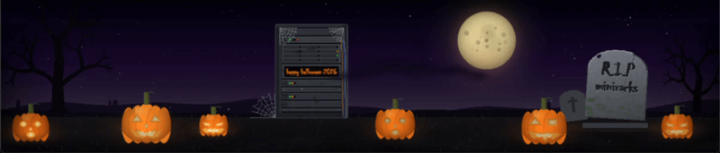

# Halloween 2026

A self-contained pygame screensaver for the
[CustomDeedsAustralia Waveshare 11.9-inch 1480×320 display](https://www.customdeedsaustralia.com/custom-steel-or-aluminium-2ru-19-rack/index.html).



A dark graveyard nightscape: a spooky shaded moon with drifting
clouds, twinkling stars, gnarled dead trees, a cobwebbed server rack with
blinking LEDs, a wandering spider and a 2RU mock Waveshare screen reading
**happy halloween 2026**, glowing carved pumpkins with flickering candle
light, drifting ground fog, flocks of flapping bats, and a tilted granite
tombstone engraved **R.I.P / miniracks** whose lettering shimmers faintly in
the moonlight.

Both texts are configurable:

```powershell
py -3.12 halloween26_screensaver.py --dev --tombstone-text "R.I.P" "miniracks" --screen-text "boo!"
```

Rare events fire every minute or three: a lightning flash, a rack "kernel
panic" (all LEDs red, dark, then a staggered reboot), a ghostly wisp rising
behind the tombstone, a shooting star, and owl eyes blinking in the tree.

Everything is procedural thus no image assets are required.

## Windows development

```powershell
cd C:\Data\Programming\Cursor\Waveshare-11.9-Screensavers\halloween26
py -3.12 -m venv .venv
.\.venv\Scripts\Activate.ps1
pip install -r requirements.txt
py -3.12 halloween26_screensaver.py --dev
```

Press **Esc** or **Q** to quit.

To see the events quickly while tuning:

```powershell
py -3.12 halloween26_screensaver.py --dev --bat-interval 2 5 --spider-interval 3 6 --rare-interval 4 8
```

## Raspberry Pi

Copy this entire folder to the Pi, then run:

```bash
cd ~/Waveshare-11.9-Screensavers/halloween26
python3 -m venv .venv
source .venv/bin/activate
pip install -r requirements.txt
python3 halloween26_screensaver.py --fullscreen
```

`--fullscreen` is required when the display uses compositor scaling such as:

```bash
wlr-randr --output DSI-1 --scale 0.75
```

For slower Raspberry Pi models (30 FPS fallback profile):

```bash
python3 halloween26_screensaver.py --fullscreen --fps 30 --detail low --render-scale 0.5
```

Disable the fog (the most expensive layer) for extra headroom:

```bash
python3 halloween26_screensaver.py --fullscreen --fps 30 --detail low --render-scale 0.5 --no-fog
```

### systemd

`systemd/halloween26.service` starts the screensaver after the graphical
session. It assumes the folder lives at
`/home/pi/Waveshare-11.9-Screensavers/halloween26` with a `.venv` inside;
edit the paths if yours differ.

```bash
sudo cp systemd/halloween26.service /etc/systemd/system/
sudo systemctl daemon-reload
sudo systemctl enable --now halloween26.service
```

## Useful options

- `--speed 1.0` - animation speed multiplier
- `--detail low|medium|high` - fog layers, clouds, twinklers, flock size, fireflies
- `--render-scale 0.5` - internal render resolution (Pi speedup)
- `--fps 30` - frame cap for slower hardware
- `--bat-interval 10 25` - seconds between bat flocks
- `--spider-interval 20 50` - seconds between spider crawls on the rack
- `--rare-interval 60 180` - seconds between rare events
- `--tombstone-text "R.I.P" "miniracks"` - engraved lines, one argument per line (1-4 lines fit)
- `--screen-text "happy halloween 2026"` - text on the rack's mock Waveshare screen
- `--no-fog` / `--no-bats` / `--no-spider` / `--no-screen` - disable individual layers
- `--seed 42` - repeatable scene layout (moon craters, rack, trees, pumpkins)
- `--frames 300` - benchmark mode (prints average FPS)
- `--screenshot out.png` - save the final 1480×320 frame (use with `--frames`)

Run `python3 halloween26_screensaver.py --help` for the complete list.

## Optional artwork overrides

The screensaver is fully procedural, but you may drop files into an `assets`
folder beside `halloween26_screensaver.py` to override specific pieces. All
paths are resolved relative to the script, never the working directory, and
a missing or unreadable file silently falls back to the procedural version.

| File | Replaces |
|------|----------|
| `assets/moon.png` | The moon disc (scaled to the moon diameter; use transparency) |
| `assets/tombstone.png` | The stone face (text is still engraved on top) |
| `assets/tombstone.ttf` | The engraving font (otherwise a system gothic/serif font) |

## Tuning constants

Scene placement and palette live near the top of `halloween26_screensaver.py`:

- `MOON_POS`, `MOON_RADIUS`, `RACK_RECT`, `TOMBSTONE`, `PUMPKINS`, `TREE_LEFT/RIGHT`
- `TOMBSTONE_LINES`, `SCREEN_TEXT`, `SCREEN_TEXT_COLOR` - default texts and screen colour
- `BAT_INTERVAL`, `SPIDER_INTERVAL`, `RARE_INTERVAL`, `FOG_PERIOD`, `SHIMMER_INTERVAL`
- `WIND_SPEED`, `BAT_SPEED`, `SPIDER_*_SPEED`
- `DETAIL_PRESETS` - per-preset layer counts
- `FACE_TEMPLATES` - the carved pumpkin faces

## License

[MIT](LICENSE). Copyright (c) 2026 CustomDeedsAustralia.
